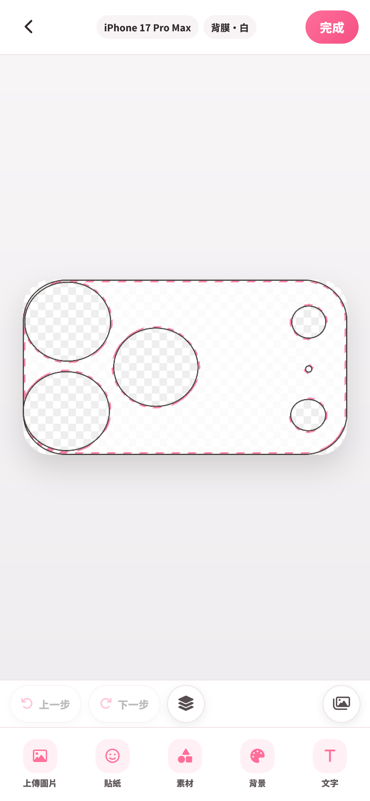

# 背膜 Retina 顯示驗收

隔離環境；使用 repo 既有公開背膜 fixture，不使用客戶訂單或圖片。基準為 PR #95 合併後的 main `ac2391f`。

## 根因與量測

PR #95 的 CSS fit 正確保留 PNG 1530:827 比例，但 Fabric 與預覽素材仍以 201×108.645 logical canvas 乘 DPR 分配像素。CSS 放大後，DPR 3 螢幕沒有足夠像素。

390×844 / WebKit / DPR 3 實測：

| 層 | 修復前 | 修復後 |
| --- | --- | --- |
| CSS 顯示尺寸 | 342×184.84375 | 342×184.84375 |
| Fabric backing | 603×325 | 1026×554 |
| 粉紅 guide | 603×327 | 1026×555 |
| 外框圖片 | 603×327 重取樣 | 原始 1530×827 |

整數像素分配使用 Fabric 原有截斷與 guide 四捨五入，最多差 1 backing pixel；所有層仍以完整來源畫布映射至同一 CSS rectangle，不裁切或改寫幾何。

## 最小修復

- 只在既有 `isFilm(model)` 為真時，讓該 Fabric instance 的顯示密度跟隨 CSS scale × min(DPR, 3)。沒有改全域 Fabric DPR。
- 配合目前固定 Fabric 5.3.1 的 retina hook；匯出時 `enableRetinaScaling=false` 仍回到 1，不把螢幕密度加入生產輸出。
- 背膜外框使用已驗證的原始 PNG；虛線由原始 mask 以相同顯示密度重畫，只有尺寸變更才重建。
- 棋盤格原本是 CSS gradient、16×16 CSS px，不是低解析 canvas；保留 CSS，不增加另一層縮放。
- 一般手機殼繼續走原本 Retina 和 overlay 路徑。

## 素材品質界線

原始 preview 與 print PNG 都是 1530×827，檔案完全未修改。Preview 有 256 種 alpha 值、18,126 個半透明像素；print mask 只有 15 種 alpha 值、527 個半透明像素。因此黑色外框原圖有抗鋸齒，但 mask 本身是較硬的邊緣。此修復消除額外的低解析放大，不修改素材的孔位、輪廓或重新平滑刀模。

## 自動驗收

`.github/tests/test_film_viewport.py` 已接入既有 WebKit / Chromium workflow：

- DPR 1 / 2 / 3；390×844、390×600、768×1024、1180×900。
- backing pixels = CSS pixels × DPR（容許整數分配誤差 1px）。
- 外框／guide／Fabric rectangle 一致；比例、置中及 24px 留白不變。
- 真實 pointer 拖曳照片、拖拉 control handle 縮放；草稿還原位置與比例。
- 實際 HQ 輸出 1899×1332、720 DPI；相機孔 alpha=0。
- 同一設計分別使用新顯示 hook 與原始 Fabric hook 重算 production PNG，逐位元相同。
- 切換一般手機殼，無背膜 hook；讀取刀模失敗仍 fail closed。

截圖為同一空白設計、相同 viewport，未裁切或重畫：

### 修復前

### 修復後

## 限制

WebKit 模擬不能取代真實 iPhone Safari 硬體驗收；仍需店主確認實機觀感。PNG 比例與現有 67×47mm 生產比例的差異延續 PR #95 的明確決策，本次不改。未修改原始刀模、列印參數、720 DPI renderer、訂單、庫存、銳印或正式資料。
